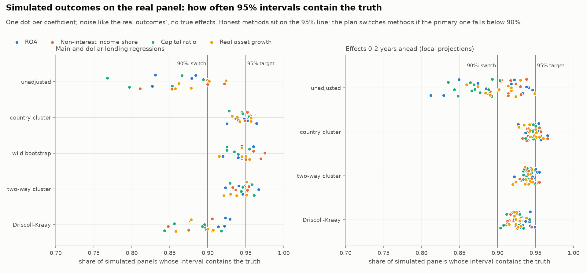

# Emerging-market banks and the macroeconomy: a 38-country panel

How do GDP growth, inflation, the policy interest rate and the exchange rate against the dollar relate to banking
sectors' profitability (ROA), non-interest income, capital adequacy and growth in emerging economies? And do
depreciations hurt banking systems that lend more in dollars more?

> **Real, public data.** IMF Financial Soundness Indicators, the World Economic Outlook, and IMF interest-rate and
> exchange-rate series, 2008-2025. Findings are associations between macro conditions and national banking systems,
> not causal effects on individual banks.

## Where the question came from

I first worked on this question in 2024, during an internship at the Central Bank of Armenia, using 16 Armenian banks
over 21 quarters. That design cannot answer it. The macro variables are the same for every bank in a quarter, so bank
fixed effects reduce to a regression of the sector average on 21 quarters. Shocks that every bank shares also make
conventional error bars far too narrow: by $\sqrt{1 + 15\rho}$, or 2.65 times if banks share 40% of their noise. This
repository answers the question with data that can: many economies, with independent economic episodes. The bank data
from the original project are not used here. How an analyst gets from such a question to an answer is set out step by
step in [docs/workflow.md](docs/workflow.md).

## Design

- **Sample by rule:** emerging and developing economies (IMF classification, April 2026) with at least 10 complete
  years. That gives 38 countries, about 570 country-years per regression.
- **Annual data:** bank ratios at year-end, because most countries report profits year to date; macro variables are
  calendar-year values.
- **Model:** $y_{ct} = a_c + d_t + \beta' x_{ct} + e_{ct}$. Country effects remove each system's normal level. Year
  effects remove the shocks all emerging economies shared. Also: effects 0-2 years ahead (local projections), and an
  interaction with the previous year's share of loans in foreign currency.
- **Plan first:** written before any estimate ([docs/plan.md](docs/plan.md)).
- **Error bars:** clustered by country with t(G - 1) critical values, wild cluster bootstrap p-values (9,999 draws),
  and a Holm adjustment across the 16 main coefficients ([docs/methods.md](docs/methods.md)).

## Checking the error bars before estimating

Before estimating, the error bars were tested by simulation on this exact panel. The simulation kept the real
countries, years and macro data, and replaced the bank outcomes with no-effect noise tuned to match the real data's
persistence, co-movement across countries, unequal noise and fat tails. Clustering by country contained the truth
92.5-96.4% of the time; unadjusted errors as little as 77%; Driscoll-Kraay 84%. Simulation is used only for this
check; every result below comes from real data ([outputs/simulation_check.md](outputs/simulation_check.md)).



## Data checks

Full details are in [outputs/data_report.md](outputs/data_report.md).

- **Year-to-date reporting:** profits are reported year to date in 111 of 119 countries, so the panel uses year-end
  values.
- **GDP:** the IMF's quarterly "constant prices" GDP disagrees with the WEO's annual growth for 8 sample countries
  (Belarus by 8.2 points a year, Armenia by 3.5), so the panel uses WEO growth.
- **Breaks:** reporting breaks in banks' assets (Armenia 2023, Argentina 2020) are handled by a rule.
- **High inflation:** the 11 country-years above 40% inflation are out of the main analysis and back in as a check.

## Results

Details are in [outputs/results.md](outputs/results.md). A "typical swing" is a macro variable's usual deviation from
its normal level once shared shocks are removed: about 2.6 points for GDP growth, and 7.8 for the exchange rate.

- **The dollar and profitability.** A typical depreciation (about 8%) goes with ROA about 0.13 points lower; average
  ROA is 2%. The result is clear (Holm-adjusted p = 0.049) and holds in most checks, but it is small. Revaluation of
  foreign-currency assets, which enlarges ROA's denominator, could explain much of it.
- **Growth and capital.** Capital ratios are slightly lower in faster-growth years (-0.23 points per typical swing),
  though not after the multiple-testing correction.
- **Asset growth.** Real asset growth rises with GDP growth. Its large links to inflation and the dollar are at least
  partly built into the measurement: inflation is the deflator, and the revaluation of foreign-currency assets alone
  could explain the dollar link.
- **Dollar lending.** Depreciations do not hurt more-dollarized banking systems more: the estimates are near zero,
  with tight intervals, for all four outcomes.
- **Growth and rates.** GDP growth and the policy rate have no large effect on profitability. For five pairs of
  variables, the data cannot tell.


**Armenia.** Armenia's 13-20 years alone give intervals 2-17 times wider than the panel's (typically 9), and all of
them contain the panel's estimates. The panel fitted without Armenia explains 30% of Armenia's year-to-year ROA changes,
but not its capital or income mix.

**Limits.** These are associations: central banks set rates in response to the economy, and banking trouble feeds
back into growth. Results are for banking systems, not individual banks. IMF data are revised over time, and the
vintages used are recorded in the data report.

## How to run

```bash
python -m venv .venv && source .venv/bin/activate
pip install -r requirements.txt
python run.py --fetch   # downloads 7 IMF extracts (about 4 MB, git-ignored), then rebuilds everything (under a minute)
python run.py --quick   # rebuild with a smaller simulation check
pytest
```

A fresh download may include IMF revisions. The outputs here come from extracts downloaded on 2026-10-16 and
2026-10-19 (SHA-256 checksums in the data report).

| Path | Contents |
|---|---|
| `config.yaml` | Every setting: data requests, sample rule, simulation check, reading rule |
| `src/embanks/` | `fetch`, `panel` and `checks` (data); `regressions`, `inference`, `simcheck` and `estimate` (analysis); `plots` |
| `outputs/` | Data report, simulation check, results and figures |
| `docs/` | `workflow.md` (the analyst's process), `plan.md`, `methods.md`, `assumptions.md` |
| `tests/` | The estimator against linearmodels, the bootstrap against wildboottest, panel construction, data hygiene |
