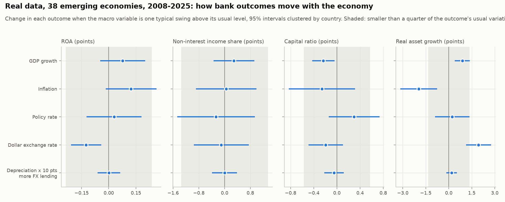
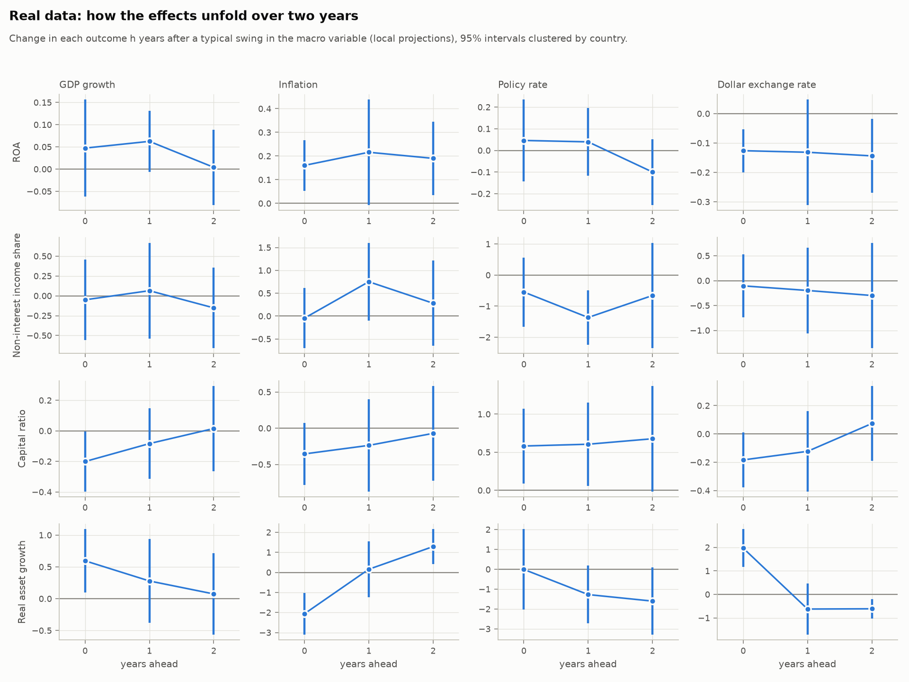

# Results: the original question on real data

*Real data from the IMF, 2008-2025; findings about real economies, not simulated.* Every choice below was fixed
before any estimate was computed (`docs/plan.md`). Error bars: country cluster
for the main and dollar-lending regressions and country cluster for effects over time, as the
simulation check selected (`simulation_check.md`); each main regression was re-run in linearmodels and agrees.

Sample: 38 emerging and developing economies; Real asset growth 547 country-years, Capital ratio 573 country-years, Non-interest income share 575 country-years, ROA 573 country-years; the 11 country-years with inflation above 40% are left out (a robustness check keeps
them). Each regression has country and year effects. Read the estimates as associations, not causal effects.

## In short

A **typical swing** is how far a macro variable usually moves from its normal level for that country, once
shocks shared by every emerging economy that year are removed (GDP growth about 2.6 points, inflation 2.9,
policy rate 3.0, dollar exchange rate 7.8). Readings follow the plan: a relationship when the 95% interval
excludes zero; "no large effect" when it includes zero but rules out a typical swing moving the outcome by more
than 0.25 of its within-country standard deviation; otherwise the data cannot tell. A relationship is called
small when its estimated effect falls inside that same band.

- **Relationships (5):** ROA - Dollar exchange rate (small); Capital ratio - GDP growth (small); Real asset growth - GDP growth (small); Real asset growth - Inflation; Real asset growth - Dollar exchange rate.
- **No large effect (10):** ROA - GDP growth; ROA - Policy rate; ROA - Depreciation x 10 pts more FX lending; Non-interest income share - GDP growth; Non-interest income share - Inflation; Non-interest income share - Dollar exchange rate; Non-interest income share - Depreciation x 10 pts more FX lending; Capital ratio - Dollar exchange rate; Capital ratio - Depreciation x 10 pts more FX lending; Real asset growth - Depreciation x 10 pts more FX lending.
- **Cannot tell (5):** ROA - Inflation; Non-interest income share - Policy rate; Capital ratio - Inflation; Capital ratio - Policy rate; Real asset growth - Policy rate.

## Mechanical links to keep in mind

Some of these relationships are partly built into how the variables are measured:

- **The dollar and bank assets.** Assets are measured in local currency, so a depreciation raises the value of
  foreign-currency assets without any new lending. With 29% of loans in foreign currency on
  average, a typical depreciation (7.7%) would by revaluation alone raise measured assets by
  about 2.3% (loans only; other foreign-currency assets add to it), against the estimated
  1.9 points [1.1, 2.8]: within the interval, so it could account for the whole estimate.
  The over-time results show part of it reversing.
- **The dollar and ROA.** The same revaluation enlarges ROA's denominator: at an average ROA of
  2.02%, that alone would lower ROA by about 0.05 points for a typical depreciation,
  against the estimated -0.13 [-0.21, -0.04]: within the interval, so it could account for the whole estimate.
  The point estimate is larger, which leans toward lower profits as well, but the data cannot settle it.
- **Inflation and real asset growth.** Real growth is nominal growth minus inflation, so when balance sheets lag
  prices, real growth falls with inflation on impact; the over-time results show it recovering after two years.
- **Many tests.** The over-time results contain 48 coefficients; 13 have intervals
  excluding zero, against about 2.4 expected by chance alone. Read them as patterns, not
  as separate findings.

## Main results (question 1) and dollar lending (question 2)

Bold: the 95% interval excludes zero. "Bootstrap p": wild cluster restricted bootstrap by country (9,999 draws);
"Holm p" adjusts it for testing 16 coefficients. "Smallest detectable": the effect per 1 point this panel finds
80% of the time (simulation check). Units: points of the outcome (ROA, capital ratio and the non-interest-income
share in percent; asset growth in log points x 100). The dollar-lending line is the extra effect of a 1-point
depreciation where 10 points more of loans are in foreign currency (per typical swing: a typical depreciation).

| outcome | macro variable | per 1 point [95% interval] | per typical swing | bootstrap p | Holm p | smallest detectable | reading |
|---|---|---|---|---|---|---|---|
| ROA | GDP growth | 0.029 [-0.018, 0.077] | 0.08 [-0.05, 0.20] | 0.216 | 1.000 | 0.047 | no large effect (rules out more than 0.20) |
| ROA | Inflation | 0.042 [-0.006, 0.091] | 0.12 [-0.02, 0.26] | 0.078 | 0.862 | 0.0659 | can't tell (could be up to 0.26) |
| ROA | Policy rate | 0.010 [-0.040, 0.060] | 0.03 [-0.12, 0.18] | 0.704 | 1.000 | 0.0586 | no large effect (rules out more than 0.18) |
| ROA | Dollar exchange rate | **-0.016 [-0.027, -0.005]** | **-0.13 [-0.21, -0.04]** | 0.004 | 0.049 | 0.0187 | relationship, small: lower (-0.13 per typical swing) |
| ROA | Depreciation x 10 pts more FX lending | 0.000 [-0.001, 0.001] | 0.00 [-0.06, 0.06] | 0.988 |  | 0.000901 | no large effect (rules out more than 0.06) |
| Non-interest income share | GDP growth | 0.112 [-0.132, 0.355] | 0.29 [-0.34, 0.93] | 0.355 | 1.000 | 0.285 | no large effect (rules out more than 0.93) |
| Non-interest income share | Inflation | 0.017 [-0.305, 0.339] | 0.05 [-0.89, 0.99] | 0.918 | 1.000 | 0.425 | no large effect (rules out more than 0.99) |
| Non-interest income share | Policy rate | -0.087 [-0.486, 0.311] | -0.26 [-1.47, 0.94] | 0.668 | 1.000 | 0.424 | can't tell (could be up to 1.47) |
| Non-interest income share | Dollar exchange rate | -0.013 [-0.123, 0.097] | -0.10 [-0.96, 0.75] | 0.824 | 1.000 | 0.104 | no large effect (rules out more than 0.96) |
| Non-interest income share | Depreciation x 10 pts more FX lending | 0.000 [-0.005, 0.005] | 0.00 [-0.39, 0.39] | 0.999 |  | 0.00509 | no large effect (rules out more than 0.39) |
| Capital ratio | GDP growth | **-0.092 [-0.169, -0.016]** | **-0.23 [-0.43, -0.04]** | 0.020 | 0.244 | 0.137 | relationship, small: lower (-0.23 per typical swing) |
| Capital ratio | Inflation | -0.089 [-0.284, 0.107] | -0.26 [-0.83, 0.31] | 0.385 | 1.000 | 0.198 | can't tell (could be up to 0.83) |
| Capital ratio | Policy rate | 0.098 [-0.047, 0.244] | 0.30 [-0.14, 0.74] | 0.167 | 1.000 | 0.184 | can't tell (could be up to 0.74) |
| Capital ratio | Dollar exchange rate | -0.025 [-0.063, 0.013] | -0.19 [-0.49, 0.10] | 0.193 | 1.000 | 0.0479 | no large effect (rules out more than 0.49) |
| Capital ratio | Depreciation x 10 pts more FX lending | -0.001 [-0.003, 0.002] | -0.05 [-0.22, 0.12] | 0.563 |  | 0.00208 | no large effect (rules out more than 0.22) |
| Real asset growth | GDP growth | **0.354 [0.156, 0.552]** | **0.88 [0.39, 1.37]** | 0.000 | 0.005 | 0.313 | relationship, small: higher (+0.88 per typical swing) |
| Real asset growth | Inflation | **-0.680 [-1.096, -0.264]** | **-1.96 [-3.15, -0.76]** | 0.008 | 0.099 | 0.466 | relationship, large: lower (-1.96 per typical swing) |
| Real asset growth | Policy rate | 0.076 [-0.299, 0.451] | 0.23 [-0.89, 1.35] | 0.683 | 1.000 | 0.42 | can't tell (could be up to 1.35) |
| Real asset growth | Dollar exchange rate | **0.252 [0.146, 0.359]** | **1.94 [1.12, 2.76]** | 0.000 | 0.005 | 0.12 | relationship, large: higher (+1.94 per typical swing) |
| Real asset growth | Depreciation x 10 pts more FX lending | 0.002 [-0.002, 0.007] | 0.18 [-0.15, 0.52] | 0.285 |  | 0.0053 | no large effect (rules out more than 0.52) |

## How the effects unfold

Change in each outcome 0, 1 and 2 years after a typical swing, controlling for last year's outcome and macro
variables (local projections). Bold: the interval excludes zero.

| outcome | coefficient | 0 years ahead | 1 years ahead | 2 years ahead |
|---|---|---|---|---|
| ROA | GDP growth | 0.05 [-0.06, 0.16] | 0.06 [-0.01, 0.13] | 0.00 [-0.08, 0.09] |
| ROA | Inflation | **0.16 [0.05, 0.27]** | 0.22 [-0.01, 0.44] | **0.19 [0.04, 0.35]** |
| ROA | Policy rate | 0.05 [-0.14, 0.24] | 0.04 [-0.12, 0.20] | -0.10 [-0.25, 0.05] |
| ROA | Dollar exchange rate | **-0.13 [-0.20, -0.05]** | -0.13 [-0.31, 0.05] | **-0.14 [-0.27, -0.02]** |
| Non-interest income share | GDP growth | -0.05 [-0.56, 0.46] | 0.06 [-0.54, 0.67] | -0.15 [-0.66, 0.36] |
| Non-interest income share | Inflation | -0.05 [-0.70, 0.61] | 0.75 [-0.10, 1.60] | 0.28 [-0.65, 1.21] |
| Non-interest income share | Policy rate | -0.54 [-1.66, 0.57] | **-1.36 [-2.24, -0.48]** | -0.66 [-2.36, 1.04] |
| Non-interest income share | Dollar exchange rate | -0.10 [-0.74, 0.53] | -0.20 [-1.06, 0.66] | -0.30 [-1.36, 0.76] |
| Capital ratio | GDP growth | **-0.20 [-0.40, -0.00]** | -0.08 [-0.31, 0.15] | 0.02 [-0.26, 0.29] |
| Capital ratio | Inflation | -0.36 [-0.78, 0.07] | -0.24 [-0.87, 0.40] | -0.07 [-0.73, 0.58] |
| Capital ratio | Policy rate | **0.58 [0.09, 1.07]** | **0.61 [0.06, 1.15]** | 0.68 [-0.02, 1.37] |
| Capital ratio | Dollar exchange rate | -0.18 [-0.38, 0.01] | -0.12 [-0.41, 0.16] | 0.07 [-0.19, 0.34] |
| Real asset growth | GDP growth | **0.60 [0.10, 1.09]** | 0.28 [-0.38, 0.94] | 0.07 [-0.57, 0.72] |
| Real asset growth | Inflation | **-2.06 [-3.11, -1.02]** | 0.16 [-1.24, 1.55] | **1.29 [0.42, 2.15]** |
| Real asset growth | Policy rate | -0.01 [-2.03, 2.02] | -1.27 [-2.73, 0.18] | -1.60 [-3.30, 0.09] |
| Real asset growth | Dollar exchange rate | **1.97 [1.17, 2.77]** | -0.62 [-1.72, 0.47] | **-0.61 [-1.02, -0.20]** |

## Robustness (plan, section 7)

Per-1-point estimates with 95% intervals; bold excludes zero. Check 6 (a market interest rate where the policy
rate is missing) needs another download and was not run.

| outcome | coefficient | main | stricter sample | keep high inflation | drop BLR, POL | drop 2020-21 | leave one country out |
|---|---|---|---|---|---|---|---|
| ROA | GDP growth | 0.029 [-0.018, 0.077] | 0.021 [-0.039, 0.080] | 0.019 [-0.031, 0.068] | 0.029 [-0.021, 0.079] | 0.026 [-0.038, 0.090] | 0.019 to 0.045 |
| ROA | Inflation | 0.042 [-0.006, 0.091] | **0.066 [0.003, 0.130]** | 0.026 [-0.005, 0.057] | 0.046 [-0.005, 0.096] | 0.043 [-0.008, 0.095] | 0.033 to 0.053 |
| ROA | Policy rate | 0.010 [-0.040, 0.060] | -0.025 [-0.081, 0.032] | 0.012 [-0.023, 0.046] | 0.016 [-0.037, 0.068] | 0.012 [-0.040, 0.064] | -0.002 to 0.018 |
| ROA | Dollar exchange rate | **-0.016 [-0.027, -0.005]** | **-0.019 [-0.033, -0.004]** | -0.012 [-0.025, 0.001] | **-0.017 [-0.028, -0.005]** | -0.012 [-0.025, 0.001] | -0.018 to -0.014 |
| ROA | FX change x FX-loan share | 0.000 [-0.001, 0.001] | 0.001 [-0.000, 0.001] | 0.000 [-0.001, 0.001] | 0.000 [-0.001, 0.001] | -0.000 [-0.001, 0.001] | -0.000 to 0.000 |
| Non-interest income share | GDP growth | 0.112 [-0.132, 0.355] | 0.087 [-0.167, 0.340] | 0.121 [-0.116, 0.358] | 0.142 [-0.098, 0.383] | 0.076 [-0.248, 0.400] | 0.058 to 0.160 |
| Non-interest income share | Inflation | 0.017 [-0.305, 0.339] | -0.108 [-0.485, 0.269] | -0.102 [-0.355, 0.152] | 0.080 [-0.219, 0.378] | -0.016 [-0.332, 0.300] | -0.035 to 0.089 |
| Non-interest income share | Policy rate | -0.087 [-0.486, 0.311] | -0.035 [-0.503, 0.432] | 0.129 [-0.059, 0.316] | -0.148 [-0.561, 0.265] | -0.078 [-0.491, 0.336] | -0.219 to -0.008 |
| Non-interest income share | Dollar exchange rate | -0.013 [-0.123, 0.097] | 0.021 [-0.111, 0.153] | -0.014 [-0.125, 0.098] | -0.026 [-0.140, 0.089] | -0.014 [-0.133, 0.106] | -0.056 to -0.000 |
| Non-interest income share | FX change x FX-loan share | 0.000 [-0.005, 0.005] | 0.002 [-0.002, 0.006] | 0.001 [-0.004, 0.006] | -0.000 [-0.006, 0.005] | 0.001 [-0.005, 0.006] | -0.001 to 0.002 |
| Capital ratio | GDP growth | **-0.092 [-0.169, -0.016]** | **-0.096 [-0.180, -0.011]** | -0.051 [-0.144, 0.043] | **-0.093 [-0.173, -0.013]** | **-0.130 [-0.245, -0.016]** | -0.108 to -0.076 |
| Capital ratio | Inflation | -0.089 [-0.284, 0.107] | -0.117 [-0.371, 0.136] | 0.086 [-0.032, 0.204] | -0.104 [-0.307, 0.098] | -0.098 [-0.308, 0.113] | -0.114 to -0.034 |
| Capital ratio | Policy rate | 0.098 [-0.047, 0.244] | 0.077 [-0.099, 0.254] | 0.055 [-0.006, 0.115] | 0.114 [-0.043, 0.271] | 0.099 [-0.054, 0.251] | 0.068 to 0.119 |
| Capital ratio | Dollar exchange rate | -0.025 [-0.063, 0.013] | -0.031 [-0.070, 0.009] | -0.031 [-0.077, 0.016] | -0.024 [-0.064, 0.016] | -0.022 [-0.064, 0.021] | -0.038 to -0.018 |
| Capital ratio | FX change x FX-loan share | -0.001 [-0.003, 0.002] | 0.000 [-0.002, 0.003] | -0.001 [-0.003, 0.001] | -0.001 [-0.003, 0.001] | -0.001 [-0.003, 0.002] | -0.001 to -0.000 |
| Real asset growth | GDP growth | **0.354 [0.156, 0.552]** | **0.391 [0.152, 0.631]** | **0.291 [0.007, 0.574]** | **0.353 [0.145, 0.560]** | **0.504 [0.305, 0.704]** | 0.290 to 0.384 |
| Real asset growth | Inflation | **-0.680 [-1.096, -0.264]** | -0.464 [-1.004, 0.076] | **-1.134 [-1.913, -0.354]** | **-0.685 [-1.133, -0.238]** | **-0.677 [-1.094, -0.260]** | -0.776 to -0.561 |
| Real asset growth | Policy rate | 0.076 [-0.299, 0.451] | -0.055 [-0.546, 0.435] | 0.108 [-0.046, 0.262] | 0.055 [-0.368, 0.479] | 0.135 [-0.238, 0.509] | 0.023 to 0.187 |
| Real asset growth | Dollar exchange rate | **0.252 [0.146, 0.359]** | **0.173 [0.072, 0.274]** | **0.314 [0.172, 0.455]** | **0.254 [0.139, 0.369]** | **0.253 [0.146, 0.359]** | 0.208 to 0.267 |
| Real asset growth | FX change x FX-loan share | 0.002 [-0.002, 0.007] | 0.002 [-0.002, 0.007] | **0.009 [0.001, 0.017]** | 0.002 [-0.003, 0.006] | 0.003 [-0.002, 0.008] | 0.001 to 0.004 |

## Armenia (plan, section 8)

**Armenia alone**, against the panel (per 1 point, 95% intervals). Armenia's own intervals use the method for short
series (equal-weighted cosine, t critical values with 2 degrees of freedom), on 13
to 20 years.

| outcome | coefficient | years | Armenia alone | 38-country panel |
|---|---|---|---|---|
| ROA | GDP growth | 20 | 0.005 [-0.079, 0.088] | 0.029 [-0.018, 0.077] |
| ROA | Inflation | 20 | 0.066 [-0.534, 0.665] | 0.042 [-0.006, 0.091] |
| ROA | Policy rate | 20 | 0.014 [-0.815, 0.844] | 0.010 [-0.040, 0.060] |
| ROA | Dollar exchange rate | 20 | -0.093 [-0.244, 0.058] | **-0.016 [-0.027, -0.005]** |
| Non-interest income share | GDP growth | 20 | -0.378 [-1.182, 0.427] | 0.112 [-0.132, 0.355] |
| Non-interest income share | Inflation | 20 | -0.603 [-5.133, 3.927] | 0.017 [-0.305, 0.339] |
| Non-interest income share | Policy rate | 20 | 1.340 [-1.962, 4.643] | -0.087 [-0.486, 0.311] |
| Non-interest income share | Dollar exchange rate | 20 | -0.393 [-0.883, 0.097] | -0.013 [-0.123, 0.097] |
| Capital ratio | GDP growth | 15 | -0.029 [-0.467, 0.409] | **-0.092 [-0.169, -0.016]** |
| Capital ratio | Inflation | 15 | 0.031 [-1.530, 1.593] | -0.089 [-0.284, 0.107] |
| Capital ratio | Policy rate | 15 | 0.083 [-1.216, 1.383] | 0.098 [-0.047, 0.244] |
| Capital ratio | Dollar exchange rate | 15 | **-0.151 [-0.279, -0.024]** | -0.025 [-0.063, 0.013] |
| Real asset growth | GDP growth | 13 | 0.138 [-0.802, 1.078] | **0.354 [0.156, 0.552]** |
| Real asset growth | Inflation | 13 | -0.233 [-5.436, 4.969] | **-0.680 [-1.096, -0.264]** |
| Real asset growth | Policy rate | 13 | -0.880 [-6.540, 4.780] | 0.076 [-0.299, 0.451] |
| Real asset growth | Dollar exchange rate | 13 | 0.323 [-0.678, 1.324] | **0.252 [0.146, 0.359]** |

**Does the emerging-market pattern describe Armenia?** The panel estimated without Armenia, applied to Armenia's
own year-to-year changes in the four macro variables (no Armenian data used to fit it):

| outcome | year-to-year changes | correlation | same direction | share of variation explained |
|---|---|---|---|---|
| ROA | 19 | 0.60 | 10 of 19 | 0.30 |
| Non-interest income share | 19 | -0.27 | 8 of 19 | -0.08 |
| Capital ratio | 14 | 0.12 | 4 of 14 | -0.04 |
| Real asset growth | 11 | 0.37 | 7 of 11 | -0.07 |
